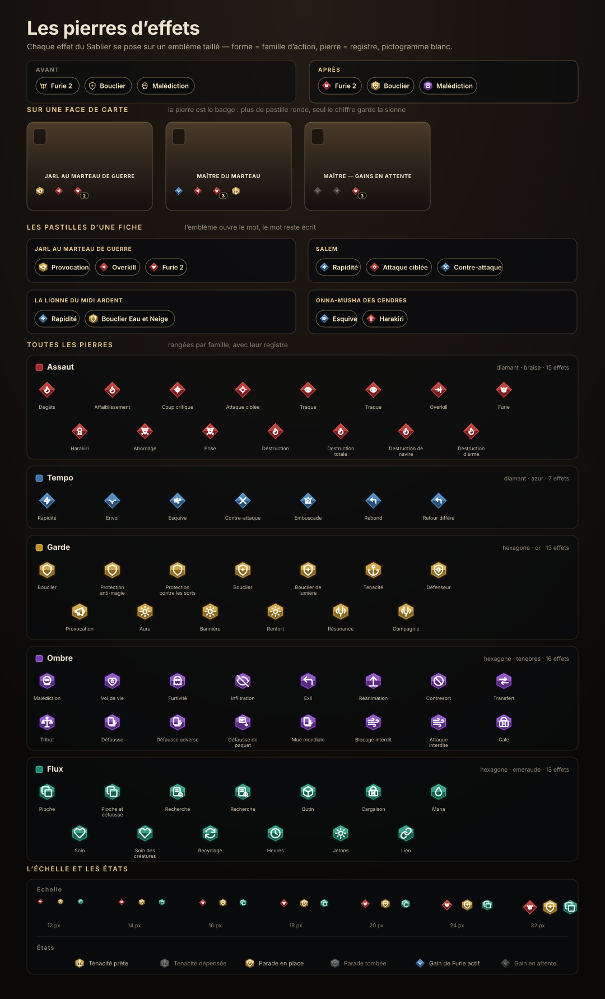

# 28 — Les pierres d'effets

Les mots-clés du Sablier ne s'impriment plus en trait doré posé à même le texte :
chaque effet porte une **pierre taillée**, un petit emblème de héros — fond
saturé, biseau clair en haut, ombre en bas, liseré sombre, pictogramme **blanc**
au centre. La référence de style est celle des emblèmes de héros des jeux
d'auto-battler : le losange braise, l'hexagone ténèbres, l'hexagone or.



## La grammaire

Deux choses se lisent d'un coup d'œil, sans lire le mot :

- **la forme dit la famille d'action** — le `diamant` pour ce qui frappe et se
  déplace, l'`hexagone` pour ce qui tient et dure ;
- **la pierre dit le registre** — braise pour le combat, azur pour le tempo, or
  pour la garde, ténèbres pour ce qui ronge, émeraude pour les ressources.

| Famille | Forme | Pierre | Effets |
| --- | --- | --- | --- |
| **Assaut** | diamant | braise | Dégâts, Affaiblissement, Coup critique, Attaque ciblée, Traque, Overkill, Furie, Harakiri, Abordage, Prise, les quatre Destructions |
| **Tempo** | diamant | azur | Rapidité, Envol, Esquive, Contre-attaque, Embuscade, Rebond |
| **Garde** | hexagone | or | Protection (et ses variantes de sorts), Bouclier, Ténacité, Défenseur, Provocation, Aura, Bannière, Renfort, Résonance, Compagnie |
| **Ombre** | hexagone | ténèbres | Malédiction, Vol de vie, Furtivité, Infiltration, Exil, Réanimation, Contresort, Transfert, Tribut, Défausses, Blocages interdits, Cale |
| **Flux** | hexagone | émeraude | Pioche, Recherche, Butin, Cargaison, Mana, Soin, Recyclage, Heures, Jetons, Lien |

Le registre complet vit dans **`src/games/effetPlaques.js`** : les silhouettes
(`PLAQUE_FORMES`), les pierres (`PLAQUE_PIERRES`) et la table des familles
(`PLAQUE_FAMILLE_EFFET`). Ajouter un effet, c'est **une ligne** dans cette table —
jamais retoucher le dessin. Une clé oubliée ne disparaît pas : elle retombe sur
la famille de son symbole (`FAMILLE_PAR_SYMBOLE`), et à défaut sur la garde.

## Le dessin

Tout tient dans un carré de **32 unités**, pour que la même pierre serve de
12 px (une main mobile) à 40 px (une planche de revue) sans redessin :

1. la **silhouette** entière en encre — c'est le contour sombre ;
2. l'**anneau** en creux — la marche du biseau ;
3. le **champ** dans la teinte de la pierre ;
4. la **moitié haute** du champ, éclaircie par la lueur ;
5. la **moitié basse**, assombrie par l'encre ;
6. le **filet** clair sur le champ — l'arête taillée ;
7. le **pictogramme**, blanc, à 13 unités (diamant) ou 18 (hexagone).

Le biseau n'a pas la même épaisseur selon la forme (`BISEAU_PAR_FORME`) :
l'**hexagone** ouvre largement son champ (anneau 82 %, champ 70 %) — c'est lui
qui porte le plus de couleur —, tandis que le **diamant**, dont les quatre
pointes rognent le centre, garde un champ resserré (78 % / 64 %) sans quoi son
pictogramme déborderait sur le contour.

L'hexagone remplit aussi son carré de plus près que le premier dessin : 28 de
large sur 30 de haut. À 18 px sur une face de carte, une pierre étroite se lisait
comme un pois à côté de son pictogramme — d'où l'ouverture jusqu'aux bords.

Les formes pointues laissent moins de place au centre : le pictogramme y est plus
petit, mais son **épaisseur apparente ne change pas** — `EPAISSEUR_SYMBOLE`
compense la réduction (`2 × 24 / taille`), pour un trait effectif de
2 unités de symbole partout.

Rien n'est deviné en CSS : la pierre est dessinée dans le SVG, ce qui la rend
insensible aux couleurs de texte qui l'entourent et vérifiable hors navigateur
(`scripts/effets-pierres-preview.mjs`).

## Où la pierre remplace l'ancienne icône

- **Pastilles** (`PastillesCarte`) : la pierre ouvre le mot, le mot reste écrit.
  Elle fait **20 px** dans la pilule.
- **Badges de face** (`IconesCarte`) : la pierre **est** le badge — plus de
  pastille ronde ni de liseré CSS ; le chiffre de l'effet (« Furie 2 ») garde sa
  petite pastille sombre, posée en bas à droite de la pierre. 18 px sur bureau,
  14 px au doigt, 16 cqw sur les cartes de la rangée.
- **Interlignage** (`IconeLigneRegle`) : 18 px devant la ligne de règle, réservé
  aux surfaces de lecture.

Les états existants suivent : une Ténacité dépensée, un Bouclier tombé ou un
gain de Furie encore en attente gardent leur pierre à leur place, éteinte par
`filter: grayscale(1)`.

## La Protection élémentaire

Une Protection teinte **sa pierre** de l'élément qu'elle repousse — Braise,
Eau, Neige, Ténèbres —, avec la palette de `PROTECTION_COULEURS`. La Protection
contre le **Sable** ne prend aucune teinte et garde la pierre or de sa famille.
Une Protection double affiche deux pierres, une par couleur.

## La revue

```bash
node scripts/effets-pierres-preview.mjs      # public/preview-effets-pierres.html
node scripts/effets-pierres-planche.mjs      # la planche SVG de cette page
node --test tests/rpg-effets-pierres.test.js # la grammaire, les formes, la feuille
```

La page de revue assemble le balisage réel (sprite + `plaqueSvg`) et
`effet-icons.css` : une face de carte, les pastilles de quatre fiches, toutes
les pierres rangées par famille, l'échelle des tailles et les états.
